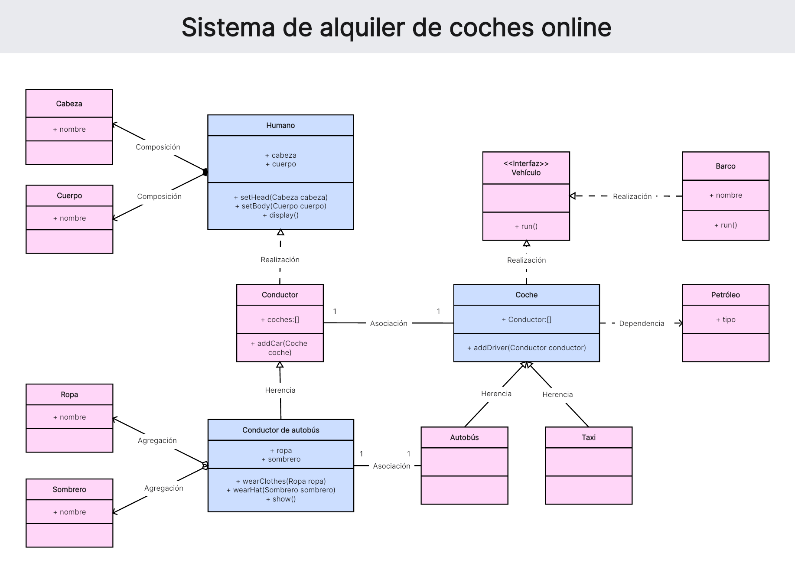

# Car Rental — Java / Spring Boot (work in progress)

**English:** Learning project for modeling a car-rental domain with Java 17, Spring Boot and JPA. The repository currently contains an application entry point and domain entities; **it does not yet expose rental-management REST endpoints**.

**Español:** Proyecto de aprendizaje para modelar el dominio de alquiler de vehículos con Java 17, Spring Boot y JPA. Actualmente incluye la aplicación base y entidades del dominio; **todavía no implementa endpoints REST para la gestión de alquileres**.

## Current implementation / Estado actual

- Spring Boot application entry point.
- JPA domain classes `Car`, `Driver` and an initial `DriverBus` class.
- MySQL datasource configuration.
- Basic Spring context test (not a complete integration test).

**Not implemented yet:** CRUD controllers, booking workflow, vehicle availability search, authentication, and complete tests. The entity mappings are also incomplete and need review before the application can be considered runnable end to end.

## Tech stack

Java 17 · Spring Boot 3.4.3 · Gradle · Spring Data JPA / Hibernate · MySQL · Lombok

## Local setup (development)

1. Install JDK 17 and MySQL.
2. Create a local MySQL database named `carrental`.
3. Set `DB_USERNAME` and `DB_PASSWORD` environment variables for your local database. **Do not commit actual credentials.**
4. Run `./gradlew bootRun` (Windows: `gradlew.bat bootRun`).

> The project is not yet feature-complete; startup may require fixing the unfinished JPA entity relationships. The repository was reviewed statically, not executed.

## Next steps

1. Correct and test JPA entity relationships.
2. Implement repositories, services, controllers and validation.
3. Add unit and integration tests.
4. Document REST endpoints with OpenAPI.
5. Add an example configuration and clear local setup instructions.

## Diagram

---

**Portfolio note:** This is a learning exercise, not a production booking system.
